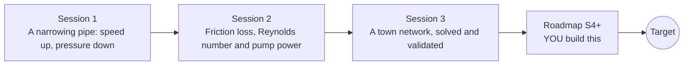

# openpipeflow

[](https://github.com/KrunalPanchal1995/openpipeflow/actions/workflows/ci.yml)   [](https://colab.research.google.com/github/KrunalPanchal1995/openpipeflow/blob/main/sessions/session-01/lesson.ipynb) [](https://krunalpanchal1995.github.io/openpipeflow/)

**Size a water pipe so the flow gets through and the pump stays cheap, in three sessions.**

openpipeflow teaches pipe flow from continuity and Bernoulli to friction loss, pump power and a small town network, using only Python and a browser.

- **Start from zero.** Session 1 needs only school algebra and the idea of pressure; every symbol is explained.
- **See it flow.** Every session ships a slider app that runs in the browser, with labelled graphs and a challenge.
- **Know you got it right.** Each session ends with a checkpoint that prints PASS or FAIL against hand calculations and analytic results.
- **Build the missing half.** The repo stops at Session 3 on purpose; the roadmap shows the path to the Target.

[Target](#the-target) · [Who is this for](#who-is-this-for) · [Quick start](#quick-start) · [Sessions](#sessions) · [Roadmap](#roadmap) · [Contribute](#contribute) · [Explainer PDF](docs/explainer.pdf)

> **This repo is incomplete on purpose.** Sessions 1 to 3 are here and fully working. The finished Target below is a preview of what the community can build next. We show you the path, not the code. Sessions 4 and up are yours.

## The Target

A small hill town's water network over one day. Water leaves a tank on the hill; dots drift along the pipes at the real flow speeds, pipes are drawn thicker where they are larger, and every junction is coloured by its pressure. In the morning peak the far corner of town turns red: pressure has sagged below the 20 m target. Your goal over the coming sessions: build the solver that makes this picture, for any network, and then make the red go away by resizing pipes.


*Target: a hill town's water network over one day, with flow dots and pressure colours*


*Target at the morning peak: the far corner drops below the pressure target*


*Math Visual Studio project: a pipe-flow solver checked against the exact Hagen-Poiseuille profile*

Try it live:

- [Math Visual Studio: internal flow (Atlas S61)](https://krunalpanchal1995.github.io/studio/#atlas?ch=S61&ex=1)
- [Math Visual Studio: project 5, fluid through a pipe (Atlas S103)](https://krunalpanchal1995.github.io/studio/#atlas?ch=S103&ex=1)

How the Target was made is shown only as a path in [promo/roadmap.md](promo/roadmap.md).

## Who is this for
**higher secondary to diploma / undergraduate (levels 4-5).** Topic area: Heat, Thermodynamics and Fluid Mechanics.

Prerequisites:

- School algebra, squares and square roots; the area of a circle.
- Python 3.10 or newer; if `python --version` works, you are ready. PRIMER.md explains the rest.
- No prior GitHub, calculus or fluid mechanics experience is needed.

New to Python? Read [PRIMER.md](PRIMER.md) first (10 minutes).

## Quick start

No installation knowledge needed. You need [Git](https://git-scm.com/downloads) and [Python 3.10+](https://www.python.org/downloads/) (Windows: tick "Add Python to PATH"). On Mac and Linux type `python3` wherever this page says `python`.

```bash
git clone https://github.com/KrunalPanchal1995/openpipeflow.git
cd openpipeflow
python start.py 1
```

`start.py` creates a private environment, installs what is needed and runs Session 1 with its checkpoint. Next: `python start.py 2`, `python start.py 3`, or `python start.py test` to check everything. Only a checkpoint: `python start.py check 1`.

A few lines turn the idea of Session 1 into a result (they work as they are): Save it as `try.py` and run it with `python start.py run try.py` (this uses the private environment, where NumPy is installed):

```python
import numpy as np
q = 0.010                                       # 10 litres per second
v = lambda d: 4 * q / (np.pi * d ** 2)           # speed from diameter: continuity
print(round(v(0.10), 3), round(v(0.05), 3))      # -> 1.273 5.093  m/s: half the width, four times the speed
```

Every session also opens in your browser with sliders (no install): [live apps](https://krunalpanchal1995.github.io/openpipeflow/). Or use the Colab badge above for the notebook.

## Sessions

| # | Session | Model level | Time | Live app |
|---|---|---|---|---|
| 1 | [A narrowing pipe: speed up, pressure down](sessions/session-01/README.md) | Level 1: conceptual interactive model | 60 min | [open](https://krunalpanchal1995.github.io/openpipeflow/session-01/) |
| 2 | [Friction loss, Reynolds number and pump power](sessions/session-02/README.md) | Level 2: mathematical engineering model | 80 min | [open](https://krunalpanchal1995.github.io/openpipeflow/session-02/) |
| 3 | [A town network, solved and validated](sessions/session-03/README.md) | Level 3: simulation and validation | 90 min | [open](https://krunalpanchal1995.github.io/openpipeflow/session-03/) |

Each session follows the same six steps: A real-world problem, B concept and theory, C visual explanation, D interactive simulation, E worked example and experiment, F assessment and design challenge. Each ends with `checkpoint.py`, which prints `PASS` or `FAIL` against reference numbers. Session 3 also contains the real-world mini-project: **Size the pipe run for a water tank on a hill**.

## Architecture



| Folder or file | What is inside |
|---|---|
| `sessions/` | three sessions: README (A-F), `lesson.py`, notebook, live app, exercises, activity sheet, checkpoint |
| `promo/` | the Target: media, live links, and the roadmap (path only) |
| `docs/` | `explainer.tex` and the built `explainer.pdf` |
| `tests/` | runs every lesson and checkpoint headless |
| `start.py` | one command to set up and run anything |
| `QUALITY.md`, `RUBRIC.md` | the quality checklist and the scoring rubric |
| `.github/` | CI, PDF build, Pages deploy, issue and PR templates |

## Roadmap

| Milestone | What you will build | Difficulty |
|---|---|---|
| Session 4: Colebrook-White friction factor | A friction factor function that replaces the Swamee-Jain formula inside the network solver. | intermediate |
| Session 5: A general network solver | A solver that reads any list of pipes, nodes and demands. | advanced |
| Session 6: Pumps and tanks as network parts | A pump element with a head-flow curve added to the network. | advanced |
| Session 7: A day of demand | A 24-hour simulation with a demand pattern and a tank level. | advanced |
| Session 8: Draw the town | A map with moving flow dots and node colours. | intermediate |

Full detail with a checkpoint per milestone: [promo/roadmap.md](promo/roadmap.md).

## Contribute
New to GitHub? Read [CONTRIBUTING.md](CONTRIBUTING.md); it starts from zero. Pick an issue labelled `good first issue`. Translations into Hindi, Telugu, Tamil and Malayalam are welcome.

<details>
<summary>Development</summary>

```bash
python start.py test        # runs every lesson and checkpoint
```
Lessons use `# %%` cell markers so they open as notebooks in VS Code. See [QUALITY.md](QUALITY.md) for the standard every session meets.
</details>

## License
MIT. See [LICENSE](LICENSE). Media in `promo/media` is (c) Krunal Panchal, CC BY 4.0.

## Acknowledgments
Part of the [PAN IIT OSS](https://hellofoss.tech-iitb.org/projects) open-source teaching collection, modelled on the structure of [openspline](https://github.com/openspline/openspline). Built on ideas from the Math Visual Studio at https://krunalpanchal1995.github.io/studio/.
