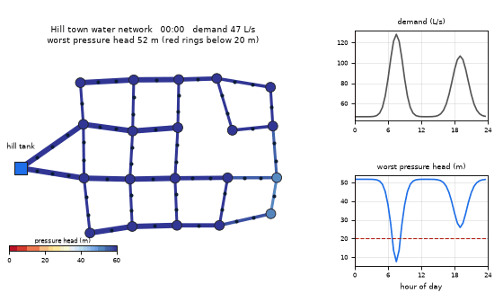
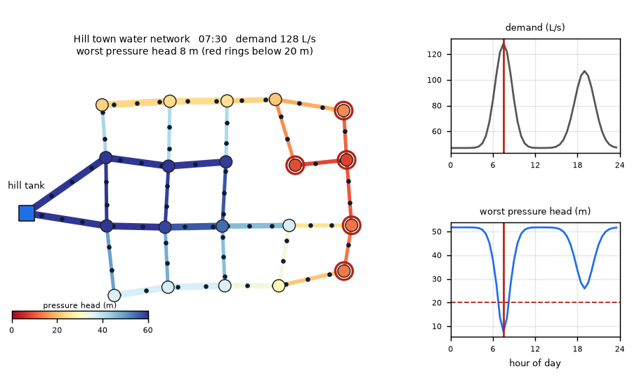
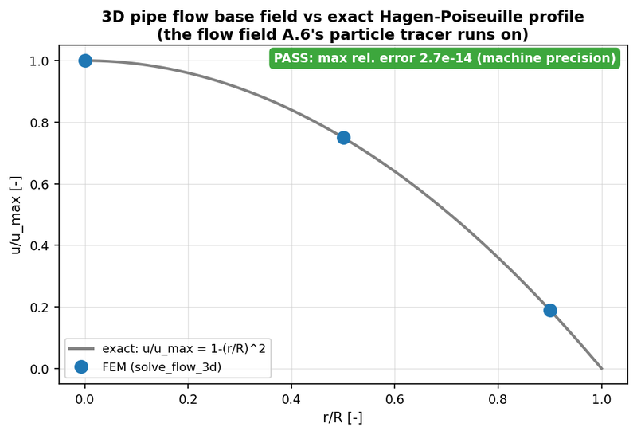

# What you are building toward

A small hill town's water network over one day. Water leaves a tank on the hill; dots drift along the pipes at the real flow speeds, pipes are drawn thicker where they are larger, and every junction is coloured by its pressure. In the morning peak the far corner of town turns red: pressure has sagged below the 20 m target. Your goal over the coming sessions: build the solver that makes this picture, for any network, and then make the red go away by resizing pipes.

*Target: a hill town's water network over one day, with flow dots and pressure colours*

*Target at the morning peak: the far corner drops below the pressure target*

*Math Visual Studio project: a pipe-flow solver checked against the exact Hagen-Poiseuille profile*

These results come from a private reference build. The code is not published; the roadmap shows the path so you can build your own.

Live links:

- [Math Visual Studio: internal flow (Atlas S61)](https://krunalpanchal1995.github.io/studio/#atlas?ch=S61&ex=1)
- [Math Visual Studio: project 5, fluid through a pipe (Atlas S103)](https://krunalpanchal1995.github.io/studio/#atlas?ch=S103&ex=1)
