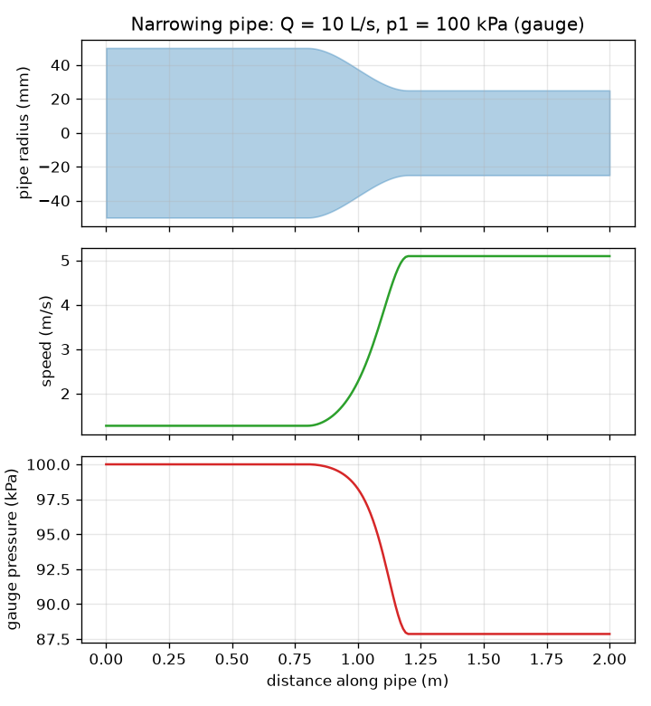
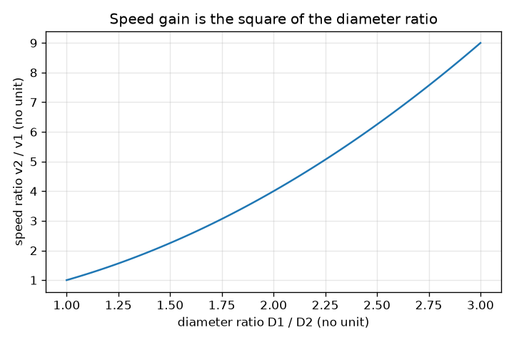

# Session 1: A narrowing pipe: speed up, pressure down

*Level 1 (conceptual interactive model) · about 60 minutes · openpipeflow*

> This is a simplified educational model. It is not a validated design tool and must not be used for real structures, electrical installations, vehicles, industrial processes or medical decisions.

**Prerequisites**

- Area of a circle, squares and square roots.
- You have read PRIMER.md and run `python start.py 1` once.

**Learning objectives.** After this session you can:

- State continuity: the volume flow rate Q is the same at every cross-section, so A1 v1 = A2 v2.
- Compute the average speed in a pipe from the flow rate and the diameter.
- Use Bernoulli's equation to find how the pressure changes when the speed changes (idealised flow).
- Read the speed and pressure profile of a pipe that narrows.

## A. Real-world problem
Put your thumb over the end of a garden hose and the water leaves faster. Water cannot be squeezed or lost on the way, so wherever the pipe is narrower the water must move faster. But a faster stream needs energy, and in a frictionless pipe that energy can only come from the pressure. So for steady, incompressible flow through a pipe that narrows, how do the average speed and the static pressure change? This session answers it for an idealised pipe with no friction; Session 2 adds the friction. This is general education about an idealised model, not guidance for building a real water system.

## B. Concept and theory
Q is the volume of water passing a cross-section each second. Because water is nearly incompressible and the flow is steady, Q is the same everywhere along the pipe. For a pipe of diameter D the area is A = pi D^2 / 4 and the average speed is v = Q / A. Halving D cuts the area to a quarter, so the speed rises four times. Bernoulli's equation says that along a level, frictionless streamline the quantity p + (1/2) rho v^2 stays constant: the term (1/2) rho v^2 is the dynamic pressure. Where v rises, the static pressure p must fall by the same amount.

| Symbol | Meaning | Unit |
|---|---|---|
| Q | volume flow rate | m^3/s (1 L/s = 0.001 m^3/s) |
| D | inside diameter of the pipe | m |
| A | cross-section area, pi D^2 / 4 | m^2 |
| v | average speed of the water | m/s |
| p | static (gauge) pressure | Pa (1 kPa = 1000 Pa) |
| rho | density of water, 998 at 20 C | kg/m^3 |

**Assumptions**

- Steady flow: nothing changes with time.
- Incompressible water of constant density.
- No friction and no heat transfer (this is why it is idealised).
- Level pipe, so height does not change; the speed is the same across the whole cross-section (average speed).

$$ Q = A\,v = \tfrac{\pi}{4}D^2\,v $$

$$ A_1 v_1 = A_2 v_2 \;\Rightarrow\; v_2 = v_1\left(\frac{D_1}{D_2}\right)^2 $$

$$ p + \tfrac12 \rho v^2 = \text{constant} \;\Rightarrow\; p_2 = p_1 + \tfrac12 \rho\,(v_1^2 - v_2^2) $$

## C. Visual explanation
The first figure shows a pipe that narrows smoothly in the middle, with the speed and the gauge pressure drawn on the same distance axis. Where the pipe is narrow the speed curve is at its highest and the pressure curve at its lowest. In the ideal model the pressure would return to its starting value only if the pipe widened back to the same size. The second figure shows the speed gain v2 / v1 against the diameter ratio D1 / D2: it is a parabola, because the area goes with the square of the diameter.

*A narrowing pipe: the speed rises and the gauge pressure falls in the narrow section.*

*The speed gain equals the square of the diameter ratio.*

## D. Interactive simulation
Run the lesson (`python start.py 1`), then open the live app: [Session 1: a narrowing pipe](https://krunalpanchal1995.github.io/openpipeflow/session-01/) (or `app.html` in this folder). Slide the narrow-section diameter down and watch the speed arrows lengthen and the colour of the pipe turn red. Open the pressure and speed graphs and compare their shapes: one is the mirror image of the other.

**Challenge.** Make the water in the narrow section faster than 5 m/s while its gauge pressure stays above zero.

## E. Worked example and experiment
**Problem.** Water flows at Q = 10 L/s through a 100 mm pipe at a gauge pressure of 100 kPa, then through a smooth narrowing to 50 mm. Find the speeds and the pressure in the narrow section.

1. Convert: Q = 10 L/s = 0.010 m^3/s. Areas: A1 = pi (0.100)^2 / 4 = 0.007854 m^2 and A2 = pi (0.050)^2 / 4 = 0.001963 m^2.
2. Speeds: v1 = 0.010 / 0.007854 = 1.273 m/s and v2 = 0.010 / 0.001963 = 5.093 m/s. Check: (100/50)^2 = 4 and 4 x 1.273 = 5.093.
3. Dynamic pressures: (1/2)(998)(1.273)^2 = 808.9 Pa and (1/2)(998)(5.093)^2 = 12 943 Pa (about 0.81 kPa and 12.94 kPa).
4. p2 = 100 kPa + 0.81 kPa - 12.94 kPa = 87.87 kPa (gauge).
5. Sanity check: p + dynamic pressure = 100.81 kPa at both ends, and a narrower pipe gave a lower pressure, as expected.

**Answer.** v1 = 1.273 m/s, v2 = 5.093 m/s (four times faster) and p2 = 87.87 kPa, a drop of 12.13 kPa.

**Experiment.** Fit two pressure gauges (or two clear vertical tubes) to a hose where it narrows and run water through at a measured flow rate (time how long a bucket takes to fill). The narrow section should show the lower pressure, as in the model. Differences come from friction and from turbulence at the sudden change in shape, which Bernoulli's equation leaves out, so real pressure drops are somewhat larger and the pressure after a widening recovers only partly.

## F. Assessment and design challenge
**Question type A: Conceptual.** A pipe narrows. Explain in words why the water speeds up and why its static pressure falls, and name one thing the idealised model leaves out.

Hint

Think about how much water must pass each second, and where the extra kinetic energy comes from.

Step-by-step solution

The same volume per second must pass every cross-section, so through a smaller area the water must move faster (A1 v1 = A2 v2). Faster water has more kinetic energy per kilogram; with no friction and no pump that energy can only come from the pressure energy, so p falls. The model leaves out friction (a real pressure also falls because of friction), turbulence and the speed differences across the cross-section.

**Question type B: Numerical.** Water at 5 L/s flows at 150 kPa gauge through an 80 mm pipe that narrows to 40 mm. Find v1, v2 and p2. Check the units.

Hint

Convert 5 L/s to m^3/s first. Use v = 4 Q / (pi D^2), then p2 = p1 + (1/2) rho (v1^2 - v2^2).

Step-by-step solution

Q = 0.005 m^3/s. v1 = 4(0.005) / (pi (0.080)^2) = 0.995 m/s. v2 = 4(0.005) / (pi (0.040)^2) = 3.979 m/s (four times, since the diameter halved). p2 = 150 kPa + (1/2)(998)(0.990 - 15.83) Pa = 150 - 7.41 = 142.59 kPa. Units: m/s for speed; kg/m^3 x m^2/s^2 = Pa for pressure terms. Sanity check: the narrow section has the lower pressure.

**Question type C: Graph and simulation interpretation.** In the app, set the narrow diameter larger than the wide one (a pipe that widens). What does the pressure graph do, and is this realistic?

Hint

Compare v2 with v1 and use p2 = p1 + (1/2) rho (v1^2 - v2^2).

Step-by-step solution

The speed falls, so the pressure curve rises above its starting value (for 100 mm widening to 150 mm at 10 L/s it goes from 100 kPa to 100.65 kPa). This is Bernoulli's pressure recovery. In a real pipe a sudden or steep widening makes the flow separate and swirl, so much of the recovery is lost; the ideal curve is the best case.

**Question type D: Design and optimisation challenge.** Design: Q = 20 L/s flows at 100 kPa gauge in a 100 mm pipe. A flow-measuring throat must reach a speed of at least 5 m/s, but the gauge pressure must stay above 80 kPa. Choose a throat diameter from 50, 60, 70, 80 mm and justify it.

Hint

Compute v and p for each diameter; the speed condition wants a small D, the pressure condition a large D.

Step-by-step solution

v1 = 2.546 m/s. For 70 mm: v = 5.197 m/s and p = 100 + (1/2)(998)(6.485 - 27.01)/1000 = 89.76 kPa: both conditions met. For 80 mm: v = 3.98 m/s, too slow. For 60 mm: v = 7.07 m/s and p = 100 + 499(6.485 - 49.97)/1000 = 78.3 kPa, which is below 80 kPa. For 50 mm: 10.19 m/s and about 51 kPa. So 70 mm is the only choice that works. Trade-off: a narrower throat gives a bigger, easier to read signal but wastes more pressure in real flow.

Score yourself with [RUBRIC.md](../../RUBRIC.md). Print the [activity sheet](activity_sheet.md) to work on paper.

## Common misconceptions
| Common misconception | What is actually true |
|---|---|
| A narrower pipe means higher pressure because the water is squeezed. | In steady flow the water speeds up, and the speed is paid for by a drop in static pressure. |
| Water speeds up in a narrow pipe because something pushes it harder. | No extra push is needed: the same flow rate must pass a smaller area, so the speed rises by continuity. |
| Bernoulli's equation works for any real pipe. | It needs steady, frictionless, incompressible flow along a streamline; with friction the total p + (1/2) rho v^2 falls along the pipe (Session 2). |

## Glossary
- **continuity**: the same volume of water passes every cross-section each second, so A v is constant
- **flow rate**: volume of water passing a cross-section each second, in m^3/s or L/s
- **gauge pressure**: pressure measured above the surrounding air pressure
- **dynamic pressure**: (1/2) rho v^2: the pressure-sized measure of the water's kinetic energy
- **incompressible**: its density does not change when pressure changes (good for water)

## Finish
1. Do the three coding tasks in [exercises.md](exercises.md).
2. Run `python start.py 1` again after your changes. It ends with the checkpoint; when it prints `PASS`, you are done. (Checkpoint only: `python start.py check 1`.)

Next: [Session 2](../session-02/README.md)
