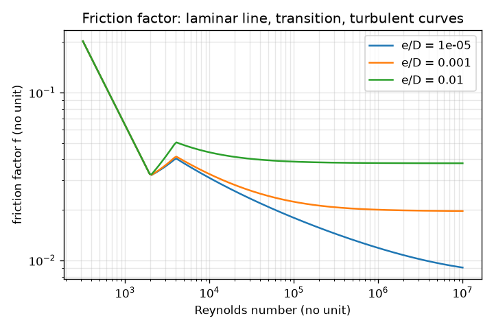
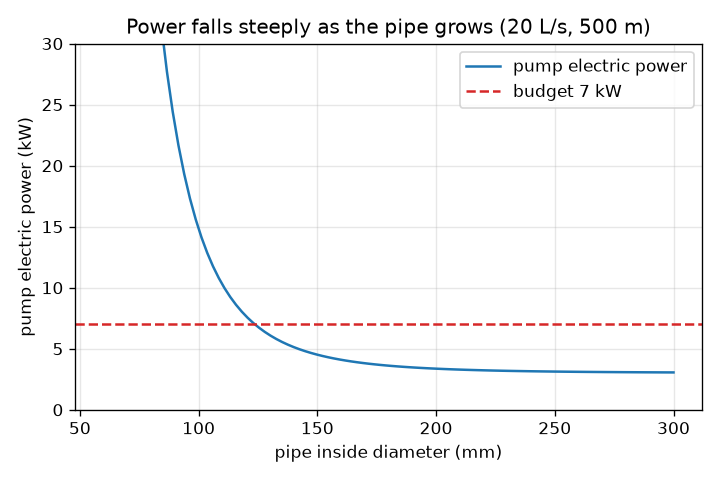

# Session 2: Friction loss, Reynolds number and pump power

*Level 2 (mathematical engineering model) · about 80 minutes · openpipeflow*

> This is a simplified educational model. It is not a validated design tool and must not be used for real structures, electrical installations, vehicles, industrial processes or medical decisions.

**Prerequisites**

- Session 1: continuity and Bernoulli.
- Powers and logarithms to base 10 (a calculator is enough).

**Learning objectives.** After this session you can:

- Compute the Reynolds number and say whether the flow is laminar or turbulent.
- Find the friction factor (64/Re when laminar, Swamee-Jain when turbulent) and the Darcy-Weisbach head loss.
- Add minor losses and the static lift to get the pump head, and convert it to electric power.
- Solve the design problem: the smallest standard diameter within a power budget and a speed limit.

## A. Real-world problem
A pump must push 20 litres of water per second through a 500 m pipe to a tank 10 m higher. A thin pipe is cheap, but the water rubs on the wall and the pump must work very hard; a fat pipe wastes less energy but costs more. How big is the friction, how much power does the pump need, and what is the smallest standard pipe that keeps the pump within a 7 kW budget? This is a simplified teaching model for sizing ideas, not a hydraulic design method; real projects need a qualified engineer, pump curves and safety factors.

## B. Concept and theory
Friction turns some of the water's energy into heat, so the head (energy per unit weight, written as a height in metres) falls along the pipe. The Reynolds number Re = v D / nu compares inertia with viscosity: below about 2000 the flow is smooth (laminar), above about 4000 it is turbulent. The Darcy-Weisbach equation gives the friction head loss h_f = f (L/D) v^2 / (2 g), where f is the friction factor: exactly 64/Re when laminar, and for turbulent flow the Swamee-Jain approximation that depends on Re and on the relative roughness e/D. Bends, valves and entrances add a minor loss h_m = K v^2 / (2 g). The pump must lift the water by the static height and also make up the losses, so H = lift + h_f + h_m, the water power is rho g Q H and the electric power is that divided by the efficiency eta.

| Symbol | Meaning | Unit |
|---|---|---|
| Re | Reynolds number | no unit |
| nu | kinematic viscosity (1.0e-6 for water at 20 C) | m^2/s |
| f | Darcy friction factor | no unit |
| e | wall roughness height (0.15 mm for an old steel pipe) | mm or m |
| L | pipe length | m |
| K | total minor-loss coefficient of bends and valves | no unit |
| H | pump head | m |
| eta | pump and motor efficiency (0.65 here) | no unit |
| P | electric power | W (1 kW = 1000 W) |

**Assumptions**

- Steady flow of water at 20 C in a full round pipe.
- Wall roughness is uniform and the pipe diameter is the inside diameter.
- Between Re = 2000 and 4000 we join the laminar and turbulent values with a straight line (the real flow is unpredictable there).
- The pump runs at constant efficiency, and the pipe ends at a tank open to the air.

$$ Re = \frac{v D}{\nu}, \qquad v = \frac{4Q}{\pi D^2} $$

$$ f = \frac{64}{Re}\;(Re<2000), \qquad f = \frac{0.25}{\left[\log_{10}\!\left(\frac{e/D}{3.7} + \frac{5.74}{Re^{0.9}}\right)\right]^2}\;(Re>4000) $$

$$ h_f = f\,\frac{L}{D}\,\frac{v^2}{2g}, \qquad h_m = K\,\frac{v^2}{2g} $$

$$ H = h_{\text{lift}} + h_f + h_m, \qquad P_{\text{elec}} = \frac{\rho g Q H}{\eta} $$

## C. Visual explanation
The first figure plots the electric power against the pipe diameter for 20 L/s through 500 m. The curve falls very steeply at small diameters and flattens after about 150 mm, where almost all that remains is the power needed to lift the water. The red dashed line is the 7 kW budget; the curve crosses it just below 125 mm. The second figure is the friction factor against the Reynolds number on log axes: a straight line for laminar flow, a jump-free transition, and then curves that flatten and sit higher for rougher pipes.

*Friction factor against Reynolds number: laminar line, transition, then turbulent curves for three roughnesses.*

*Pump electric power against pipe diameter: steep at small sizes, then flat; the dashed line is the 7 kW budget.*

## D. Interactive simulation
Run the lesson (`python start.py 2`), then open the live app: [Session 2: pipe friction and pump power](https://krunalpanchal1995.github.io/openpipeflow/session-02/) (or `app.html` in this folder). Change the diameter and watch the red friction bar grow as the pipe gets thinner. In the power graph find where the curve crosses the budget line, then change the flow rate or length and see how the crossing moves.

**Challenge.** Bring the pump power to 7 kW or less with the speed at 3 m/s or less.

## E. Worked example and experiment
**Problem.** Water at 20 L/s goes through 500 m of 125 mm pipe (roughness 0.15 mm, K = 5) to a tank 10 m higher. The pump and motor are 65 percent efficient. Find the electric power.

1. Q = 0.020 m^3/s, D = 0.125 m. v = 4(0.020) / (pi (0.125)^2) = 1.630 m/s. Velocity head v^2 / (2 g) = 2.656 / 19.62 = 0.1354 m.
2. Re = v D / nu = 1.630 x 0.125 / 1.0e-6 = 203 700, which is turbulent. Relative roughness e/D = 0.00015 / 0.125 = 0.0012.
3. Swamee-Jain: log10(0.0012 / 3.7 + 5.74 / 203 700^0.9) = log10(0.000324 + 0.0000957) = -3.3768, squared 11.402, so f = 0.25 / 11.402 = 0.0219 (the code gives 0.02193).
4. Friction loss h_f = 0.0219 x (500 / 0.125) x 0.1354 = 11.87 m. Minor loss h_m = 5 x 0.1354 = 0.68 m.
5. Pump head H = 10 + 11.87 + 0.68 = 22.55 m. Water power = 998 x 9.81 x 0.020 x 22.55 = 4415 W.
6. Electric power = 4415 / 0.65 = 6793 W, about 6.79 kW: just inside the 7 kW budget. Speed 1.63 m/s is below 3 m/s.

**Answer.** v = 1.63 m/s, Re = 203 700, f = 0.0219, h_f = 11.87 m, h_m = 0.68 m, H = 22.55 m, electric power 6.79 kW. The next smaller standard size, 100 mm, needs 14.8 kW, so 125 mm is the smallest that fits 7 kW.

**Experiment.** Measure the pressure drop along a straight hose or pipe of known length at two or three flow rates (a bucket and stopwatch give Q, a U-tube manometer or two gauges give the loss). Plot loss against Q: the model predicts growth close to Q squared. Expect the model to be within roughly 10 to 20 percent because the true roughness of your pipe, its real inside diameter, joints and any partly closed valve are not known exactly. The model is a good guide, not a measurement.

## F. Assessment and design challenge
**Question type A: Conceptual.** Why does doubling the pipe diameter reduce the friction loss by much more than a factor of two for the same flow rate?

Hint

Count how D enters through v and through the factor L/D.

Step-by-step solution

For fixed Q the speed is v = 4Q / (pi D^2), so v^2 goes as 1/D^4, and the loss h_f = f (L/D) v^2 / (2 g) has another 1/D, giving about 1/D^5 (f also changes a little). Doubling D therefore cuts the loss by about 2^5 = 32 times (the code gives 34.8 times between 100 mm and 200 mm because f changes). That is why a slightly larger pipe saves a lot of pumping power.

**Question type B: Numerical.** 12 L/s of water flows through 200 m of 100 mm pipe of roughness 0.15 mm. Find the speed, Reynolds number, friction factor, head loss and the power lost to friction (no minor losses).

Hint

v = 4Q / (pi D^2), then Re, then e/D = 0.0015 for Swamee-Jain, then h_f, then rho g Q h_f.

Step-by-step solution

v = 4(0.012) / (pi (0.1)^2) = 1.528 m/s; v^2 / (2 g) = 0.119 m. Re = 1.528 x 0.1 / 1.0e-6 = 152 800 (turbulent). f = 0.0233. h_f = 0.0233 x (200 / 0.1) x 0.119 = 5.54 m. Power lost = 998 x 9.81 x 0.012 x 5.54 = 651 W. Units: m/s, no unit, no unit, m, W. Sanity check: the speed is moderate and the loss of 2.8 m per 100 m is plausible for a pipe of this size.

**Question type C: Graph and simulation interpretation.** Read the power-against-diameter curve for 20 L/s, 500 m, 10 m lift. About what power is needed at 100 mm, 125 mm and 200 mm, and what limits the curve for large diameters?

Hint

Use the app: set each diameter and read the electric power.

Step-by-step solution

At 100 mm about 14.8 kW, at 125 mm 6.79 kW and at 200 mm 3.37 kW. For very large pipes the friction vanishes and the power approaches the lift term alone: rho g Q (10 + small minor loss) / 0.65 = 3.0 kW. Extra diameter then buys almost nothing, while the pipe cost keeps rising. The best size is therefore where the curve first meets the budget, not the largest pipe.

**Question type D: Design and optimisation challenge.** Design: the same job (20 L/s, 500 m, 10 m lift, K = 5, roughness 0.15 mm, 65 percent efficient) but a smaller budget of 5 kW. Choose a standard size from 100, 125, 150, 200 mm. What if the budget were 4 kW? Justify with speed and trade-offs.

Hint

Use smallest_diameter(budget, ...) or the power numbers 14.8, 6.79, 4.51 and 3.37 kW.

Step-by-step solution

5 kW: 125 mm needs 6.79 kW (too much), 150 mm needs 4.51 kW (fits), so choose 150 mm with speed 1.13 m/s. 4 kW: 150 mm fails, 200 mm needs 3.37 kW and fits, speed 0.64 m/s. Trade-off: each step up in size costs more for the pipe and trench but saves running cost; a low speed also reduces noise and water hammer. Assumptions: constant 65 percent efficiency and clean water; a real design adds a margin and pump curves.

Score yourself with [RUBRIC.md](../../RUBRIC.md). Print the [activity sheet](activity_sheet.md) to work on paper.

## Common misconceptions
| Common misconception | What is actually true |
|---|---|
| Friction loss is proportional to the speed. | In turbulent flow it is close to proportional to v^2, so doubling the flow roughly quadruples the loss. |
| A smooth pipe has no friction loss. | Even a perfectly smooth pipe has loss from viscosity; roughness only adds to it (f never falls to zero). |
| Pump power depends only on how high the water is lifted. | The pump also pays for friction, so a long thin pipe can cost far more power than the lift. |
| A bigger pipe is always the best design. | Beyond a point the power saving is tiny while the pipe cost keeps rising. |

## Glossary
- **head**: energy per unit weight of water, written as a height in metres
- **Reynolds number**: v D / nu: compares inertia with viscosity; large means turbulent
- **laminar**: smooth, layered flow (Re below about 2000)
- **turbulent**: churning, mixing flow (Re above about 4000)
- **friction factor**: the number f in the Darcy-Weisbach equation
- **minor loss**: head lost at bends, valves and entrances, written K v^2 / (2 g)
- **efficiency**: fraction of the electric power that ends up as water power

## Finish
1. Do the three coding tasks in [exercises.md](exercises.md).
2. Run `python start.py 2` again after your changes. It ends with the checkpoint; when it prints `PASS`, you are done. (Checkpoint only: `python start.py check 2`.)

Next: [Session 3](../session-03/README.md)
