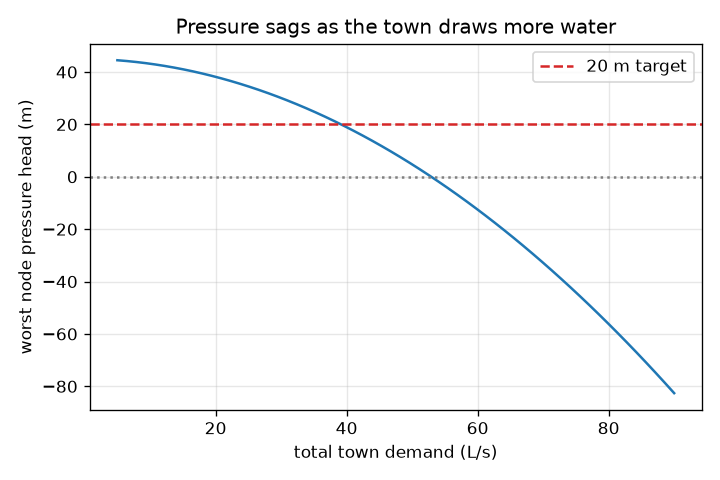
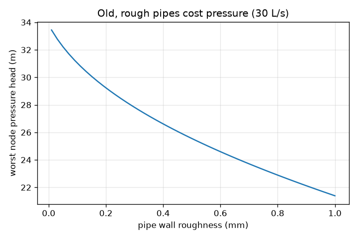

# Session 3: A town network, solved and validated

*Level 3 (simulation and validation) · about 90 minutes · openpipeflow*

> This is a simplified educational model. It is not a validated design tool and must not be used for real structures, electrical installations, vehicles, industrial processes or medical decisions.

**Prerequisites**

- Session 2: friction loss and head.
- Session 1: continuity (flow in equals flow out).

**Learning objectives.** After this session you can:

- Describe a looped pipe network by its pipes, nodes, heads and demands.
- Solve the flows with the Hardy Cross loop correction (Newton's method) and compute the pressure at every node.
- Validate the solver: single-pipe agreement, mass conservation at nodes, zero head change around the loop, symmetry and an analytic laminar result.
- Test the sensitivity to roughness and viscosity and find a failure case.

## A. Real-world problem
A town is fed from a tank on a hill. Pipes branch and close into a loop, and each street takes some water. No formula gives the flow in each pipe; it must be found numerically. And a number from a program is worth nothing until it has been checked. Can you solve a small looped network, prove the answer is right, and see which pipe sizes keep every node above 20 m of pressure head? This is a simplified teaching model, not a hydraulic design tool: real networks need hydraulic modelling software, peak-demand analysis, fire flows and regulation.

## B. Concept and theory
A network obeys two laws. Continuity: at every node the flow in equals the flow out plus the demand. Energy: around every closed loop the head losses add to zero, because water cannot gain energy by going round in a circle. The head loss of each pipe depends on its own flow through Darcy-Weisbach, so the equations are not linear. Hardy Cross starts with flows that obey continuity, then adds a correction x to the loop flow: we need F(x) = h2 + h4 - h3 = 0, and Newton's method gives x_new = x - F / F', where F' is the sum of the slopes dh/dQ of the loop pipes. Once the flows are known, the heads follow by subtracting the pipe losses from the tank level, and pressure head is head minus street level.

| Symbol | Meaning | Unit |
|---|---|---|
| Q_i | flow in pipe i (negative if it runs against the arrow) | m^3/s |
| x | flow in the cross pipe B to C, the loop unknown | m^3/s |
| h_i | signed head loss of pipe i | m |
| H | hydraulic head at a node | m |
| z | street level at a node | m |
| pressure head | H - z | m of water (1 m = 9.79 kPa) |
| F | head-loss imbalance around the loop | m |

**Assumptions**

- Steady flow, water at 20 C, demands fixed (60 percent at B, 40 percent at C).
- The tank water level stays at 70 m.
- One loop only (A, B, C); no pumps or valves; no minor losses.
- Friction from Darcy-Weisbach with the same friction factor as Session 2.

$$ \sum Q_{\text{in}} - \sum Q_{\text{out}} - q_{\text{demand}} = 0 \quad\text{(each node)} $$

$$ F(x) = h_2(Q_2) + h_4(x) - h_3(Q_3) = 0, \qquad Q_2 = q_B + x,\; Q_3 = q_C - x $$

$$ x_{k+1} = x_k - \frac{F(x_k)}{\sum_i \mathrm{d}h_i/\mathrm{d}Q_i} $$

$$ H_A = H_T - h_1, \quad H_B = H_A - h_2, \quad H_C = H_A - h_3, \quad \text{pressure head} = H - z $$

## C. Visual explanation
The first figure plots the worst node pressure head against the total town demand. It falls smoothly and steeply: at the default pipes it is 30 m at 30 L/s, drops below the 20 m target near 40 L/s (18.9 m at 40) and is negative at 60 L/s. The second figure shows the worst pressure against pipe roughness at 30 L/s: older, rougher pipes lose pressure steadily. Together they show that the town can be resized (bigger main) or tolerated only up to a demand.

*Worst node pressure head against total demand; the dashed line is the 20 m target.*

*Worst node pressure head against pipe roughness at 30 L/s.*

## D. Interactive simulation
Run the lesson (`python start.py 3`), then open the live app: [Session 3: a small town network](https://krunalpanchal1995.github.io/openpipeflow/session-03/) (or `app.html` in this folder). Open the map and read the flow in each pipe. Raise the demand and watch the node colours turn red from the far end. Then enlarge the main pipe and the branches and see which change recovers the most pressure. Change the roughness and viscosity sliders and compare their effects.

**Challenge.** Serve 50 L/s or more with the main-pipe speed at 1.5 m/s or less, branch pipes of at least 150 mm, and the two diameters adding to at most 400 mm.

## E. Worked example and experiment
**Problem.** The tank (level 70 m) feeds node A through a 1200 m, 200 mm main (roughness 0.15 mm). Pipes 2, 3 and 4 are 125 mm. The town takes 30 L/s (18 L/s at B, 12 L/s at C). Find the main-pipe loss and the pressure head at A by hand, then check the numerical flows and pressure at the other nodes.

1. Main pipe: Q = 0.030 m^3/s, D = 0.200 m, v = 4(0.030) / (pi (0.2)^2) = 0.955 m/s, v^2 / (2 g) = 0.04648 m.
2. Re = 0.955 x 0.2 / 1.0e-6 = 190 986 and e/D = 0.00075, so Swamee-Jain gives f = 0.02021.
3. h1 = f (L/D) v^2 / (2 g) = 0.02021 x (1200 / 0.2) x 0.04648 = 5.64 m.
4. Head at A = 70 - 5.64 = 64.36 m; street level 20 m, so the pressure head at A is 44.36 m (about 434 kPa).
5. The program's Hardy Cross finds the loop flow in 4 iterations: Q2 = 16.17, Q3 = 13.83 and Q4 = -1.83 L/s (the cross pipe runs from C to B). Losses are 9.42 m, 9.29 m and -0.13 m.
6. Checks: at node B the inflow is 16.17 + 1.83 = 18.00 L/s, equal to its demand; round the loop 9.42 - 0.13 - 9.29 = 0.00. Pressure heads: B = 39.94 m and C = 30.07 m, so the worst node is C.

**Answer.** Main pipe loss 5.64 m, pressure head at A 44.36 m; flows 30.00, 16.17, 13.83 and -1.83 L/s; pressure heads B 39.94 m and C 30.07 m. Every node is above the 20 m target and mass is conserved to 1e-12 m^3/s.

**Experiment.** Find a hose reel or a garden pipe loop with two taps and a pressure gauge at each, and compare the gauge readings with the model for two different tap settings. Expect only rough agreement: real pipes have unknown roughness (it grows with age), unknown fittings, taps with their own losses and elevation errors of a metre or more, and the model uses a single fixed demand. The model gets the trend (opening a tap lowers the pressure at the far end) right; it should never be used to guarantee a real supply.

## Real-world application and mini-project: Size the pipe run for a water tank on a hill
A village wants a pump at a stream to fill a tank on a hill 45 m higher. The pipe run is 900 m long, the fittings add a total loss coefficient K = 3, the tank must be refilled at 15 L/s and the pump plus motor is 65 percent efficient. The pump supply allows at most 12 kW electric. Use `pipe_run_power` from Session 3 with the standard sizes 50, 65, 80, 100, 125, 150 and 200 mm (wall roughness 0.15 mm).

**Deliverable:** A script that prints, for each standard size, the speed, the electric power and whether it fits the budget and a speed limit of 2.5 m/s, then names the smallest size that does, with one sentence on what changes if the lift is 55 m.

**Success looks like:** The script chooses 150 mm (11.3 kW, 0.85 m/s), shows that 125 mm needs 13.0 kW and fails the budget, and reports that the static lift alone needs 10.2 kW.

## F. Assessment and design challenge
**Question type A: Conceptual.** Why must the head losses around a closed loop add up to zero, and what does the sign of the flow in the cross pipe (pipe 4) tell you?

Hint

Think of walking around a loop and returning to the same node.

Step-by-step solution

The head at a node is a single number. Walking round a loop and returning to the start, the sum of the head drops (taking each in the direction of travel) must be zero, otherwise the node would have two different heads. A negative flow in pipe 4 means the water actually runs from C to B, against the arrow drawn from B to C: the shorter, bigger route through pipe 3 is carrying part of B's demand.

**Question type B: Numerical.** For the default network at 30 L/s, the flow in pipe 3 is 13.83 L/s and in pipe 2 is 16.17 L/s. Check the continuity at node A and find the speed in pipe 3 (125 mm).

Hint

Node A: flow in from pipe 1 equals the sum of flows out in pipes 2 and 3. Speed = 4 Q / (pi D^2).

Step-by-step solution

Out of A: 16.17 + 13.83 = 30.00 L/s, equal to the 30.00 L/s that the main delivers: balance zero. Speed in pipe 3: v = 4(0.01383) / (pi (0.125)^2) = 1.127 m/s. Units: L/s converted to m^3/s by dividing by 1000. Sanity check: speeds around 1 m/s are typical for town mains.

**Question type C: Graph and simulation interpretation.** In the pressure-against-demand graph, where does the worst node pressure cross the 20 m target with the default pipes, and what does the shape of the curve say?

Hint

Use the app with the default pipes and change the total demand slider.

Step-by-step solution

At 30 L/s the worst pressure head is 30.07 m; at 36 L/s it is 23.8 m; at 40 L/s 18.9 m, so the crossing is a little below 40 L/s (about 39 L/s). The curve bends downward faster at higher demand because the friction loss grows roughly with the square of the flow. A small increase in demand near the limit therefore costs more pressure than the same increase at low demand. Below zero the pressure head is not physical for a real supply.

**Question type D: Design and optimisation challenge.** Design: the town must serve 50 L/s with every node at 20 m or more. With 200 mm main and 125 mm branches, does it work? Choose a main from 200, 220, 250 mm and a branch from 125, 150 mm and justify.

Hint

Use min_pressure_head(d_main=..., d_branch=..., total_lps=50).

Step-by-step solution

200/125: worst pressure is 4.7 m at C, which fails. 250/125 gives 15.0 m, still failing: the branches are the bottleneck. 200/150 gives 20.0 m, only just. 220/150 gives 25.9 m and 250/150 gives 30.3 m. Choose the 220 mm main with 150 mm branches: it meets the target with a margin and keeps the main speed at 1.32 m/s. Trade-off: pipe cost grows with diameter, so we stop at the smallest sizes that pass with a margin; a real design would also check peak hours, fire flow and ageing.

Score yourself with [RUBRIC.md](../../RUBRIC.md). Print the [activity sheet](activity_sheet.md) to work on paper.

## Common misconceptions
| Common misconception | What is actually true |
|---|---|
| A numerical answer from a program is right if it converges. | Convergence only means the equations were satisfied; you still check mass balance, loop closure, a known single-pipe case and a limit. |
| Water in a loop divides equally between the branches. | It divides so that the head loss is the same along both routes, so a longer or thinner branch carries less. |
| Viscosity and roughness matter equally. | Over the range of ordinary water temperatures viscosity moves the result by well under a metre here, while doubling the roughness costs several metres. |
| Negative pressure head just means very low pressure. | In the model it means the supply cannot deliver that flow; real pipes would draw in air or contaminated water. |

## Glossary
- **node**: a point where pipes meet or water is taken out
- **loop**: a closed circuit of pipes
- **Hardy Cross**: a method that corrects the loop flow step by step until the head losses cancel
- **demand**: the flow taken out of the network at a node
- **pressure head**: pressure written as a height of water: head minus street level
- **validation**: checking a numerical answer against exact or independent results

## Finish
1. Do the three coding tasks in [exercises.md](exercises.md).
2. Run `python start.py 3` again after your changes. It ends with the checkpoint; when it prints `PASS`, you are done. (Checkpoint only: `python start.py check 3`.)

Next: the [roadmap](../../promo/roadmap.md). Session 4 is yours to build.
